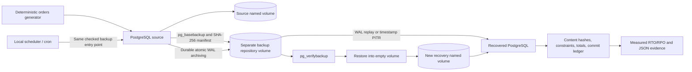

# PostgreSQL Backup & Disaster Recovery Lab

A local DevOps portfolio project that proves physical backups can restore real
business data after a database crash, loss of the source volume, and an accidental
DELETE. It measures recovery time and acknowledged transaction loss instead of
calling an open port a successful recovery.

The stack is PostgreSQL 17.11, Docker Compose, native PostgreSQL backup tools,
Python's standard library and GNU Make. No cloud account, paid API, external
storage, host PostgreSQL installation or Python dependency installation is needed.

## Confirmed local results

A complete run on 2026-10-12 passed all three recovery exercises and six additional
checks. The source named volume was actually removed before its recovery.

| Exercise | RTO (seconds) | Observed RPO / rollback gap (seconds) | Omitted acknowledged orders |
| --- | ---: | ---: | --- |
| full-backup-restore | 20.650 | 0.000000 | 0 |
| source-volume-loss | 25.763 | 12.492706 | 25 |
| delete-and-pitr | 18.714 | 9.113017 | 25 intentionally omitted |

PITR intentionally omits the later batch; its gap is a rollback window. The
source-volume exercise deliberately loses one unarchived batch.
Full evidence and definitions: [exercise report](docs/exercise-report.md).
[Successful GitHub Actions integration run](https://github.com/hundrik3/pSQL-DRL/actions/runs/38282189905)
used the same complete fault suite with pinned Node.js 24 Actions.

## Architecture



The recovered server has no mount of the source volume and no replication
connection to the source. Its repository mount is read-only. Every test gets its
own UUID, labelled resources and isolated internal Docker network; no database
port is published. Normal interactive resources are separate from test resources.

## Quick start

Install Docker Engine or Docker Desktop with Linux containers, Docker Compose v2,
Python 3.10+ and GNU Make. Allow roughly 1 GB of local disk and pull access to Docker
Hub for the pinned image. Commands below run from this repository's root.

```sh
make up
make seed
make check
make backup
make verify
make restore
make check SERVICE=recovery
make test
```

make test executes real faults and removes only its own temporary Docker resources.
It preserves ignored results/<project>/ reports and leaves the interactive lab
untouched. On failure, it exits nonzero and preserves completed-check evidence.

| Command | Purpose |
| --- | --- |
| make up | Create/start the isolated source and bind its repository identity |
| make seed | Commit another deterministic batch of 25 orders and items |
| make check [SERVICE=recovery] | Check business data, content hashes and live constraints |
| make backup | Create and verify a full physical backup; apply retention |
| make archive | Force and confirm a WAL durability barrier |
| make verify [BACKUP=id] | Verify a retained full backup including required base WAL |
| make restore [BACKUP=id] | Restore into a new empty volume and replay archived WAL |
| make pitr BACKUP=id TARGET='timestamp+00:00' | Recover to an explicit time before a bad commit |
| make test | Run the isolated integration/fault suite with measured results |
| make schedule INTERVAL=3600 | Run the local foreground backup scheduler |
| make schedule-once | One scheduled attempt; suitable for cron; preserves exit status |
| make status | Show this interactive lab's containers |
| make down | Stop the interactive lab without deleting data |
| make clean | Delete only the interactive lab's labelled containers, network and volumes |

Full installation, recovery, scheduling, diagnosis and local-file cleanup:
[recovery runbook](docs/runbook.md). State and random passwords are generated under
ignored .local/. Do not delete that directory before resource cleanup. No Docker
prune command is used.

## What the exercises prove

- A verified full backup starts on a separate empty PostgreSQL volume with identical
  customer, product, order, item and ledger content.
- An archived post-backup transaction survives SIGKILL and actual deletion of the
  source volume. A deliberately unarchived acknowledged transaction is lost and
  its commit-time gap is measured.
- Timestamp PITR restores orders deleted by an erroneous transaction, including
  their cascadingly deleted items, while intentionally excluding later commits.
- Corrupted data, missing data and missing required base-backup WAL are rejected.
- Two full backups survive retention, and the oldest retained one is restored.
- A scheduled backup succeeds; stopping the source makes the same entry point
  return nonzero and produce a failed record; the good backup remains usable.
- A real expendable volume with mismatched ownership is refused and left intact
  by the controller before the test fixture is explicitly removed.

Data checks compare counts and SHA-256 hashes of all ordered table contents,
constraint definitions, order/item sums and actual rejected writes for unique,
NOT NULL, foreign-key and CHECK constraints. A batch ledger records actual
PostgreSQL commit timestamps to measure recovery point and missing batch IDs.

## Evidence and limitations

See [measurement methodology](docs/measurement.md),
[architecture decisions and official documentation](docs/decisions.md), and the
completed exercise report under docs/.

Backups on the same computer cannot survive loss of that entire computer. This
lab has no off-host copy, immutable storage, encryption at rest or signed catalog.
Checksums detect accidental corruption, not malicious replacement of a backup
and its colocated manifest. WAL retention covers one original source timeline;
client cutover and backup of a promoted replacement primary are outside scope.
Local superuser/socket access is a lab convenience, not a production security model.

These small-workload RTO/RPO values are observations, not production guarantees.
PITR intentionally discards wanted later commits too; they need reconciliation.
archive_timeout is not an RPO guarantee. Review the pinned image for future minor
security updates. GitHub Actions uses standard hosted Linux runners: free for
public repositories; private repositories depend on included account minutes.
